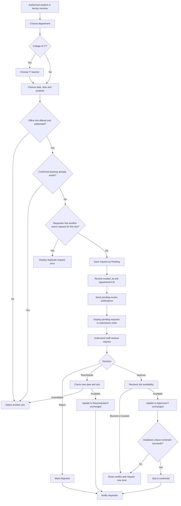

# SPCC Pass: Revised Appointment Workflow

The system accepts multiple pending requests for the same department, date and time. An authorized administrator or the designated department approver makes the booking decision. The first request to be stored is displayed first for review, but it is not automatically approved.

## Rules implemented

- Requests are timestamped by Supabase. `created_at` orders reviews chronologically, with appointment ID as a deterministic tie-breaker.
- The server does not measure network latency or award approval to the fastest connection.
- Pending requests do not reserve slots. Multiple different users may submit the same department, date and time.
- One user cannot submit two simultaneously active requests for an identical department, date and time. A partial unique index enforces this even during concurrent requests.
- A partial unique index allows only one Approved or Rescheduled appointment for a given department, date and time.
- Approval rechecks office availability and blocked dates. Only the currently expected status may be updated, to prevent double decisions and duplicate notifications when staff act simultaneously.
- A competing pending request stays Pending after another request wins the slot. Staff should reject or reschedule the competing request.
- The teacher name for College of IT is saved and displayed, but conflicts are currently determined by department, not individual teacher. This preserves existing capacity rules until the college specifies teacher-level scheduling requirements.
- When an approved booking is cancelled, its slot becomes available again.
- Emails are sent after a successful appointment operation. A failed notification does not reverse the database record.

## Panel defense example

Two students submit a College of IT request for the same date and 10:00 AM slot. Both are recorded as Pending, with their own server timestamps. The review list shows the earlier submitted request first, while the approver retains the decision. The first successfully confirmed approval reserves the department slot, and the database rejects any second confirmed booking for that slot.
